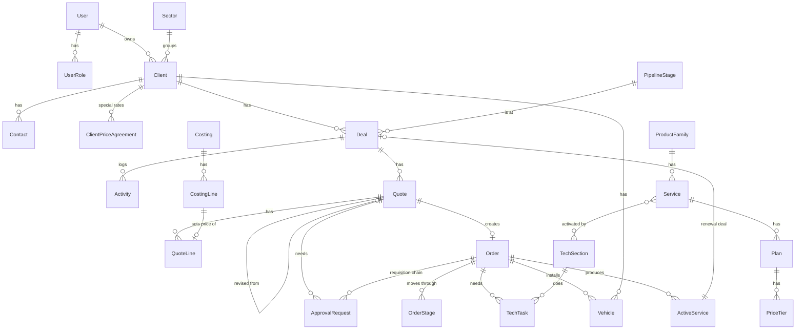

# Somtel Enterprise Sales System: Design v3

Status: **approved**. Phase 1 is built. v3 adds the customer and catalog structure agreed after Phase 1 (see section 0).

## 0. Changes in v3 (agreed after Phase 1)

### 0.1 Somtel services catalog: Category -> Service -> Plan -> price
`ProductFamily` is renamed `ServiceCategory`. The price lives on the plan (one price, or volume bands).
This catalog now holds only Somtel's own services (Non-IT and the tracking platform fee). IT resale items moved to the IT catalog.

### 0.2 Customers: Group -> Entity -> Person
| Table | Key fields | Notes |
|---|---|---|
| `ClientGroup` | name, sectorId, ownerId, notes | Optional. Sector and owner are defaults copied to new entities (each entity can change them). Option to push them to all entities. |
| `Client` (entity) | + groupId | The legal company quoted, contracted and billed. Quotes, orders, services and renewals always belong to an entity. |
| `Contact` (person) | clientId (home entity) | |
| `ContactEntityLink` | contactId, clientId | A person can also work with other entities **in the same group** (for example a group CFO). Links are removed if an entity leaves the group. |

### 0.3 IT catalog: Vendor -> Category (shared) -> Product -> Sub-product
| Table | Key fields | Notes |
|---|---|---|
| `Vendor` | name, website, notes | Fortinet, Sophos, Microsoft, Ubiquiti, tracker brand |
| `ItCategory` | name, sortOrder | **One shared list** for all vendors (Firewall and security, Wireless, ...) |
| `ItProduct` | vendorId, categoryId, name, description | For example FortiGate 60F |
| `ItSubProduct` | productId, name, sku, kind (HARDWARE / SOFTWARE), quoteDescription, unitLabel, termMonths, markupPct | Hardware: default markup 20%, customs allowed. Software: default 10%, no customs, term for renewals. No fixed price. |
| `Distributor` | name, country, currency, paymentTerms, remittanceNotes, contacts | Never shown on client documents |
| `VendorDistributor` | vendorId, distributorId, partnerLevel, accountNumber, notes | Many to many |
| `DistributorPrice` | distributorId, subProductId, unitCost, currency, exchangeRate, quotedAt, reference | Cost history. The last cost per distributor is shown, cheapest first. A cost can only come from a distributor linked to the product's vendor. Phase 3 costings will add rows automatically. |

Trackers, speed limiters and dashcams moved to the IT catalog (vendor "Tracker vendor (sample)" in demo data, category "Vehicle tracking hardware"). The $1.40 platform fee stays in the services catalog.

Who sees costs: Admin, Head, Manager, Account Managers, Enterprise Support, Procurement, Finance. Billing and Tech do not.
Who records costs: the same, except Finance.

Stack: Next.js (App Router) + TypeScript, PostgreSQL + Prisma, Tailwind + shadcn/ui,
Auth.js (email + password now, Microsoft 365 later), Docker Compose, `docx` for Word,
headless Chromium for PDF (approved), SMTP via Nodemailer, `exceljs` for Excel.

Docker Compose runs three containers: `app` (web), `worker` (scheduled jobs and email sending), `db` (PostgreSQL).
The worker handles stale deals, follow-up reminders, renewal alerts (90 / 60 / 30 days), quote expiry and the email queue.

---

## 1. Business rules confirmed

### 1.1 Costing (IT and vendor-sourced lines). Internal only, never on a client document

Per costing line:

| Input | How it works | Default |
|---|---|---|
| Supplier unit cost | In the supplier currency | |
| Supplier currency + exchange rate | Rate is typed as "1 USD = X supplier currency" (for example AED 3.6725). USD lines use rate 1 | Last rate used for that currency is suggested |
| Quantity | | |
| Markup % | On supplier cost only. Editable per line (15%, 20%, 50% seen in past deals) | Licences 10%, hardware 20% |
| Remittance | % of supplier cost | 0.4% |
| Bank charges | Either % of supplier cost, or a fixed amount per shipment (set on the costing) | 0.9% |
| Freight | Per line, one of: per kg (kg per unit x qty x rate per kg), per unit, or a fixed amount for the line | |
| Customs | Fixed $ amount, per unit or per line. **Hardware lines only**; locked at 0 for licences | |
| Other fees | Fixed $ amount with a label (for example vendor order handling fee) | |

Formulas (all in USD):

```
supplier cost      = (supplier unit cost / exchange rate) x qty
markup             = supplier cost x markup %
remittance         = supplier cost x remittance %
bank charges       = supplier cost x bank %            (percentage mode)
                   = shipment amount x (line supplier cost / costing supplier cost)   (fixed mode, shared by value)
line selling total = supplier cost + markup + remittance + bank charges + freight + customs + other fees
selling unit price = line selling total / qty, rounded to 2 decimals
landed cost        = line selling total - markup
profit             = markup
profit % of sale   = profit / line selling total
```

Worked example (to check the maths):
10 access points at AED 367.25 each, rate 3.6725, markup 20%, freight 1.2 kg per unit at $3.50 per kg, customs $15 per unit.

| Item | Amount |
|---|---|
| Supplier cost (10 x 367.25 / 3.6725) | $1,000.00 |
| Markup 20% | $200.00 |
| Remittance 0.4% | $4.00 |
| Bank charges 0.9% | $9.00 |
| Freight (10 x 1.2 x 3.50) | $42.00 |
| Customs (10 x 15) | $150.00 |
| **Line selling total** | **$1,405.00** |
| Selling unit price on the quote | $140.50 |
| Profit | $200.00 (14.2% of sale) |

Only the selling unit price and line total go to the quote.

### 1.2 Price checks and special pricing approval

A quote needs Manager approval before it can be sent if **any** of these is true:
- a catalog-priced line (Non-IT services, tracking fee, devices) is priced below its catalog price, or below the client's approved special rate
- a costed line has a markup % below the **floor** for its kind (licence floor and hardware floor, set by Admin)
- if a floor is not set yet, only the catalog price check applies

The approver sees each flagged line: the reason, the normal price (or floor), and the requested price (or markup).

### 1.3 A2P SMS pricing

- Volume pricing: **all** SMS are charged at the rate of the band that the total volume falls in. 40,000 SMS = 40,000 x $0.02 = $800.
- **Special package rates per client**: a client price agreement (fixed rate or own bands), approved by the Manager. Once approved,
  quotes for that client use it with no further approval.

### 1.4 Quotes

- Currency: always USD.
- **VAT switch on each quote** (off by default). VAT % is set in settings. VAT is worked on the total after discount.
  Totals: Subtotal, Discount, VAT (if on), TOTAL.
- Reference: free text typed by the user, any format (Som-Q0145, SOM-P-189, SOM-P-100170, P0179). Only check: no duplicates.
  The check ignores upper / lower case and leading and trailing spaces, so `som-q0145` counts as a duplicate of `Som-Q0145`.
  The last used reference is shown as a hint.
- Validity: default **10 days**, maximum **15 days** (both in settings).
- T&C: templates (IT resale, A2P SMS, IVR, Tracking, General) plus saved **clauses** that can be added with one click. Seed clauses:
  - Payment: "100% upfront payment."
  - Scope: "Supply and delivery only. Installation and configuration excluded."
- Each quote line is marked **one-time** or **monthly**, so the system can report one-time revenue and MRR separately.

### 1.5 Orders

- Order numbers are **automatic**: `ORD-2026-0001`, restarting at 0001 each year (the format is a setting).
- Non-IT stages 1 to 3 are filled in automatically from the quote dates (created, sent, accepted).
- IT stage 6 approval chain (Manager, then Head of Enterprise, then Finance): if anyone rejects, the order goes **back to the
  Sales / Account Manager** with the reason and the name of the person who rejected it. Sales fixes the deal or quote (a new quote
  version if prices change) and resubmits. Each round is kept in the history.

### 1.6 Vehicle tracking

- One record **per vehicle**: plate, make, model, year, device type, IMEI / serial, device ownership (outright or Somtel-owned),
  install date, activation date, monthly fee (default $1.40, editable), status.
- The monthly fee for each vehicle starts on its own activation date.
- Totals per order and per client (vehicles, active vehicles, MRR).
- Built for 2,000+ vehicles: paged and searchable grid, Excel import and export of vehicle lists, bulk actions
  (set install date, activate selected).

### 1.7 Reports

- Revenue won is shown as two numbers, never added together: **one-time revenue** (setup, hardware, licences) and **MRR**.
- Renewal rate = renewals won / renewals due in the same period.

---

## 2. Data model

### 2.1 Conventions on every table

- `id` (cuid), `createdAt`, `updatedAt`, `createdById`
- `deletedAt` on every business table (soft delete only)
- Money `Decimal(14,4)`; client-facing totals rounded to 2 decimals
- Every change to business tables writes an `AuditLog` row with before and after values

### 2.2 People, access and settings

| Table | Key fields | Notes |
|---|---|---|
| `User` | name, email (unique), passwordHash, phone, active, `managerId` → User | Reporting line |
| `UserRole` | userId, role | ADMIN, HEAD_OF_ENTERPRISE, MANAGER, ACCOUNT_MANAGER, ENTERPRISE_SUPPORT, PROCUREMENT, FINANCE, BILLING, TECH |
| `Sector` | name, active, sortOrder | Seed: Private & INGOs, Public Sector, Financial Institutions, Logistics, Government |
| `UserSector` | userId, sectorId | |
| `TechSection` | name, email, active | |
| `UserTechSection` | userId, techSectionId | |
| `Setting` | key, value (JSON) | Remittance %, bank %, VAT %, validity default and max, markup defaults, markup floors, follow-up days, stale days, working week, billing start rule, sign-off required, order number format, tracking fee default, SMTP |
| `CompanyProfile` | name, address, phone, email, website, logo path, footer | |
| `PipelineStage` | name, sortOrder, probability, kind (OPEN / WON / LOST), active | |
| `LostReason` | name, active | No competitor name field |
| `TermsTemplate` | name, category, body | |
| `TermsClause` | category (PAYMENT / SCOPE / DELIVERY / WARRANTY / OTHER), text, sortOrder | Quick-add clauses |
| `SalesTarget` | userId, month, oneTimeTarget, mrrTarget | |
| `NumberSequence` | key (for example `ORDER`), year, lastValue | Safe auto numbering (row lock) |
| `ExchangeRate` | currency, ratePerUsd, updatedAt | Last used rate, suggested on new costings |

### 2.3 Clients

| Table | Key fields | Notes |
|---|---|---|
| `Client` | name, sectorId, industry, address, city, ownerId, status (PROSPECT / ACTIVE / INACTIVE), notes, upsellNotes | |
| `Contact` | clientId, name, title, phone, email, isDecisionMaker | |
| `ClientPriceAgreement` | clientId, planId, rateType (FIXED / OWN_BANDS), unitPrice, validFrom, validTo, status (PENDING / APPROVED / REJECTED / EXPIRED), approvedById | Special SMS package rates (and any other plan) |
| `ClientPriceAgreementTier` | agreementId, fromQty, toQty, unitPrice | For OWN_BANDS |

### 2.4 Catalog

| Table | Key fields | Notes |
|---|---|---|
| `ProductFamily` | name, enabled, sortOrder | SmartPay and MLB Internet start off |
| `Service` | familyId, name, description, productType (IT / NON_IT / TRACKING), itemKind (LICENCE / HARDWARE / SERVICE), active | itemKind sets default markup, floor and whether customs is allowed |
| `ServiceTechSection` | serviceId, techSectionId | |
| `Plan` | serviceId, name, priceType, unitPrice, unitLabel, includedUnits, billingFrequency (ONE_TIME / MONTHLY), active | priceType: ONE_TIME, MONTHLY, PER_UNIT, PER_MINUTE, PER_SMS_TIERED, MARGIN_PERCENT |
| `PriceTier` | planId, fromQty, toQty, unitPrice | Volume bands |

### 2.5 Pipeline

| Table | Key fields | Notes |
|---|---|---|
| `Deal` | clientId, title, productType, stageId, oneTimeValue, monthlyValue, probability, expectedCloseDate, ownerId, nextStep, nextFollowUpAt, lostReasonId, lostNote, lastActivityAt, wonAt, lostAt, renewalOfServiceId | Weighted one-time and weighted MRR shown separately |
| `DealProduct` | dealId, planId, description, qty, oneTimeValue, monthlyValue | |
| `Activity` | type (CALL / MEETING / EMAIL / NOTE / STAGE_CHANGE / SYSTEM), clientId, dealId, quoteId, orderId, userId, occurredAt, subject, body | |

### 2.6 Costing, quotes and approvals

| Table | Key fields | Notes |
|---|---|---|
| `Costing` | dealId, quoteId, vendorName, vendorRef, bankMode (PERCENT / FIXED_PER_SHIPMENT), bankPct, bankFixedAmount, remittancePct | Rates copied from settings when created, editable |
| `CostingLine` | costingId, description, serviceId, itemKind, supplierUnitCost, supplierCurrency, exchangeRate, qty, markupPct, freightMode (NONE / PER_KG / PER_UNIT / PER_LINE), freightKgPerUnit, freightRate, freightAmount, customsMode (NONE / PER_UNIT / PER_LINE), customsAmount, otherFeesAmount, otherFeesLabel; stored results: supplierCostUsd, markup, remittance, bankCharge, freight, customs, landedCost, sellingUnitPrice, lineTotal, profit | Results are recalculated on every save by one tested function |
| `Quote` | reference, referenceKey (lowercase, trimmed, unique), docType (QUOTATION / PROPOSAL), clientId, contactId, dealId, version, parentQuoteId, status, issueDate, validityDays, validUntil, subtotal, discountType, discountValue, vatEnabled, vatPct, vatAmount, total, oneTimeTotal, monthlyTotal, termsText, notes, sentAt, acceptedAt, rejectedAt | Status: DRAFT, PENDING_APPROVAL, APPROVED, SENT, ACCEPTED, REJECTED, EXPIRED, SUPERSEDED |
| `QuoteLine` | quoteId, lineNo, planId, costingLineId, priceAgreementId, item, description, qty, unitPrice, catalogUnitPrice, billingFrequency, lineTotal | One consolidated table |
| `ApprovalRequest` | entityType (QUOTE / PRICE_AGREEMENT / REQUISITION), entityId, round, stepNo, approverRole, approverId, status (PENDING / APPROVED / REJECTED / CANCELLED), reasons (JSON), comment, decidedAt | Round number keeps the history after a rejection and resubmit |

### 2.7 Orders

| Table | Key fields | Notes |
|---|---|---|
| `Order` | orderNumber (auto), orderType (NON_IT / IT / TRACKING), clientId, dealId, quoteId, ownerId, status (OPEN / RETURNED_TO_SALES / ACTIVATED / COMPLETED / CANCELLED), currentStageId, billingApprovedAt, billingApprovedById, activatedAt, billingStartDate, erpPrNumber, vendorName, vendorPoNumber, customerPoNumber | |
| `OrderLine` | orderId, serviceId, planId, description, qty, unitPrice, billingFrequency, lineTotal | Copied from the accepted quote; refreshed if Sales resubmits a new version |
| `StageDefinition` | flowType (NON_IT / IT), key, name, sortOrder, ownerRole, targetWorkingDays | Target days editable |
| `OrderStage` | orderId, stageDefinitionId, assigneeId, status (WAITING / IN_PROGRESS / DONE / RETURNED), receivedAt, finishedAt, notes | Days spent counted in working days |
| `TechTask` | orderId, techSectionId, status (LOCKED / OPEN / DONE), notes, completedAt, completedById | Locked until Billing approves |
| `VendorPayment` | orderId, amount, currency, exchangeRate, paidAt, reference | |
| `Vehicle` | clientId, orderId, plate, make, model, year, deviceType, imei, serialNo, deviceOwnership (OUTRIGHT / SOMTEL_OWNED), installedAt, activatedAt, monthlyFee, status (PENDING / INSTALLED / ACTIVE / SUSPENDED / REMOVED) | One row per vehicle; IMEI unique; indexed for 2,000+ rows |

### 2.8 Renewals

| Table | Key fields | Notes |
|---|---|---|
| `ActiveService` | clientId, orderId, serviceId, planId, name, qty, startDate, endDate, billingStartDate, billingFrequency, renewalValue, status (ACTIVE / RENEWED / CANCELLED / EXPIRED), renewalDealId, alert90SentAt, alert60SentAt, alert30SentAt | Created on activation or handover; can be added by hand or imported. Tracking fees live on `Vehicle`, not here |

### 2.9 System

| Table | Key fields | Notes |
|---|---|---|
| `Attachment` | entityType, entityId, kind (SIGNED_CONTRACT / CUSTOMER_PO / VENDOR_PI / DELIVERY_NOTE / OTHER), fileName, storagePath, mimeType, size, uploadedById | Docker volume |
| `Notification` | userId, type, title, body, link, readAt | |
| `EmailOutbox` | to, cc, subject, html, attachments, status, attempts, lastError, sentAt | |
| `AuditLog` | userId, action, entityType, entityId, before, after, ip, at | |
| `ImportJob` | type (CATALOG / CLIENTS / CONTACTS / TRANSACTIONS / VEHICLES), fileName, mapping, previewRows, status, result | |

### 2.10 Main relationships



---

## 3. Screens

Navy sidebar, white content, gold for the active menu item and main buttons. Top bar: global search (clients, deals,
quote references, order numbers, plates, IMEI) and the notification bell.

| # | Screen | Who uses it | Phase |
|---|---|---|---|
| 1 | Login, forgot password, reset password | All | 1 |
| 2 | My profile (name, password, email preferences) | All | 1 |
| 3 | My dashboard (home) | Sales | 1 shell, 6 full |
| 4 | Clients list (search, filters, export) | Sales, managers | 1 |
| 5 | Client page: contacts, deals, quotes, orders, active services, vehicles, special rates, renewals, timeline, upsell notes | Sales, managers | 1 (tabs fill in later) |
| 6 | Client and contact forms (side panel) | Sales | 1 |
| 7 | Catalog: families (on / off), services, plans, volume bands, tech sections per service | Admin edits, others read | 1 |
| 8 | Settings: users and roles, sectors, pipeline stages, lost reasons, tech sections, costing defaults (markups, floors, remittance %, bank %), VAT %, quote validity (default and max), timers, stage target days, working week, order number format, tracking fee, T&C templates and clauses, SMTP (with test email), company details and logo, sales targets | Admin | 1 (grows each phase) |
| 9 | Pipeline kanban (drag to move; Lost asks for a reason) | Sales, managers | 2 |
| 10 | Pipeline table with filters and totals (one-time, MRR, weighted) | Sales, managers | 2 |
| 11 | Deal page: summary, products, activities, quotes, orders, quick log | Sales | 2 |
| 12 | My follow-ups (due today, overdue) | Sales | 2 |
| 13 | Costing calculator: one row per vendor line, currency and rate, markup, freight mode, customs mode, other fees, bank mode; live totals and profit; "Send prices to quote" | Sales | 3 |
| 14 | Quote editor: reference (duplicate check, last used hint), type, client, contact, lines from catalog, costing or special rate, discount, VAT switch, validity, T&C with clause picker, live preview | Sales | 3 |
| 15 | Quote page: status, versions, approval status, PDF and Word download, email, Accept / Reject, "Create Order" | Sales | 3 |
| 16 | Special rates (client price agreements): request, view, expiry | Sales, Manager | 3 |
| 17 | Approvals inbox: quotes, special rates, requisitions (reason, normal price or floor, requested price) | Manager, Head, Finance | 3 |
| 18 | Orders list (filters: type, stage, owner, late, returned to sales) | All order roles | 4 |
| 19 | Non-IT order page: stages, contract upload, Billing approval, tech tasks per section | Sales, Billing, Tech | 4 |
| 20 | IT order page: 12-stage timeline (who holds it, received and finished dates, days spent, late in red), attachments, approval chain with rejection history, resubmit | Sales, Support, Procurement, Finance | 4 |
| 21 | My tasks: everything handed to me | Support, Procurement, Finance, Billing, Tech | 4 |
| 22 | Tech section task board | Tech | 4 |
| 23 | Tracking order page: IT timeline plus vehicles grid (paged, search by plate or IMEI, bulk install / activate, Excel import and export, totals) | Sales, Support, Tech | 5 |
| 24 | Client fleet view: all vehicles for one client, active count, MRR | Sales, Billing | 5 |
| 25 | Renewals: due in 30 / 60 / 90 days, expired, "Create renewal deal" | Sales, managers | 5 |
| 26 | Notifications page | All | 5 |
| 27 | Manager dashboard | Manager | 6 |
| 28 | Head of Enterprise dashboard | Head | 6 |
| 29 | Order tracking report (average days per stage, bottleneck team) | Managers, Head | 6 |
| 30 | Reports: pipeline, won revenue (one-time and MRR), win rate, renewal rate, targets vs actual; filters and Excel export | Managers, Head | 6 |
| 31 | Import wizard: upload, map columns, preview, fix, save (catalog, clients, contacts, transactions, vehicles) | Admin | 6 |
| 32 | Audit log | Admin, Head | 6 |

---

## 4. Points I have assumed (say if any is wrong)

1. **Exchange rate direction**: typed as "1 USD = X supplier currency" (AED 3.6725).
2. **Fixed bank charge per shipment** is shared across the lines by supplier cost, so each line's selling price carries its share.
3. **Selling unit price** is rounded to 2 decimals; the line total is unit price x qty (so the client document always adds up).
4. **Rejection and resubmit** restarts the approval chain from the Manager.
5. **Pipeline value** is shown as one-time and MRR separately, the same as the reports.
6. **Special client rates** have an end date (optional); after it the catalog price applies again.

---

## 5. Build plan after OK

Phases 1 to 6 as in the brief. Each phase ends with migrations, seed data, tests for its rules, and a working
`docker compose up`. Rule tests include: free-text unique quote reference, costing maths (the worked example above,
remittance 0.4%, bank 0.9% and fixed mode, no customs on licences, AED conversion), SMS volume banding,
approval below catalog price or floor, VAT on and off, validity max 15 days, tech tasks locked until Billing approves,
order activates only when every tech task is done, rejection returns to Sales, per-vehicle fee start dates.
