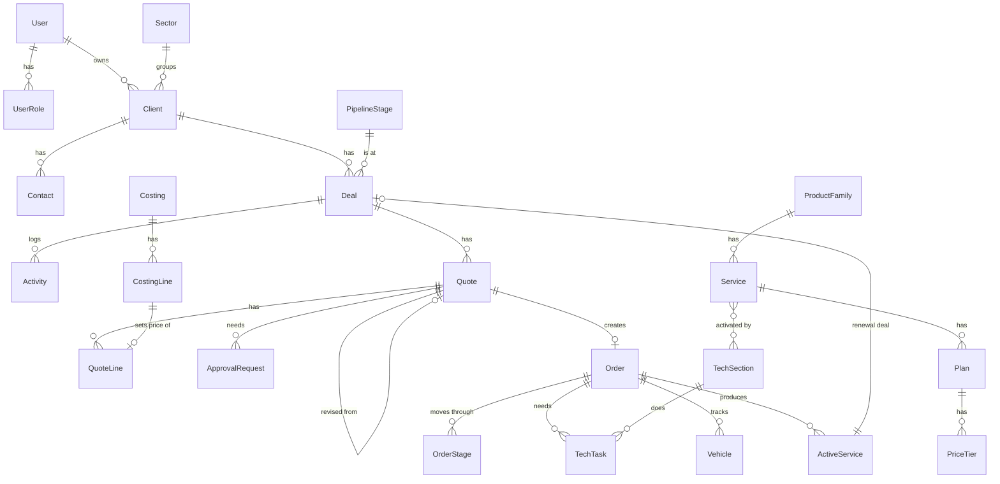

# Somtel Enterprise Sales System: Design (Step 1, for approval)

Status: **draft, waiting for OK**. No application code is written yet.

Stack as requested: Next.js (App Router) + TypeScript, PostgreSQL + Prisma, Tailwind + shadcn/ui,
Auth.js (credentials now, Microsoft Entra ID later), Docker Compose, `docx` for Word,
headless Chromium for PDF, SMTP via Nodemailer, `exceljs` for Excel.

One addition: a small **worker** container (same codebase) for scheduled jobs: stale deals,
follow-up reminders, renewal alerts at 90/60/30 days, quote expiry, and sending queued emails.
Without it, reminders only fire when someone opens the app.

---

## 1. Conventions used by every table

- `id` (cuid), `createdAt`, `updatedAt`, `createdById`
- `deletedAt` on every business table (soft delete only; normal queries hide deleted rows)
- Money is stored as `Decimal(14,4)`, currency code on the record (default `USD`)
- Every create / update / delete on business tables writes an `AuditLog` row (before and after values)

## 2. Data model

### 2.1 People, access and settings

| Table | Key fields | Notes |
|---|---|---|
| `User` | name, email (unique), passwordHash, phone, active, `managerId` → User | `managerId` gives the reporting line (Sector Manager → Manager → Head) |
| `UserRole` | userId, role | Many roles per user. Roles: ADMIN, HEAD_OF_ENTERPRISE, MANAGER, ACCOUNT_MANAGER, ENTERPRISE_SUPPORT, PROCUREMENT, FINANCE, BILLING, TECH |
| `Sector` | name, active, sortOrder | Seed: Private & INGOs, Public Sector, Financial Institutions, Logistics, Government |
| `UserSector` | userId, sectorId | Which sectors an Account Manager / Sector Manager covers |
| `TechSection` | name, email (group mailbox), active | Admin adds real names |
| `UserTechSection` | userId, techSectionId | Tech users see only their sections' tasks |
| `Setting` | key, value (JSON) | Bank charge %, stale days, follow-up days, quote validity days, working week, billing start rule, sign-off required, min margins, SMTP, etc. Typed and validated in code |
| `CompanyProfile` | name, address, phone, email, website, logo path, footer text | Used on all documents |
| `PipelineStage` | name, sortOrder, probability, kind (OPEN / WON / LOST), active | Seed: Lead 10, Qualified 25, Proposal Sent 50, Negotiation 75, Won 100, Lost 0 |
| `LostReason` | name, active | Seed: Price, Competitor, No budget, No response, Other. No field for a competitor's name |
| `TermsTemplate` | name, category (IT_RESALE / A2P_SMS / IVR / TRACKING / GENERAL), body (rich text) | |
| `SalesTarget` | userId, month (YYYY-MM), amount | Monthly revenue target per sector manager |

### 2.2 Clients

| Table | Key fields | Notes |
|---|---|---|
| `Client` | name, sectorId, industry, address, city, ownerId → User, status (PROSPECT / ACTIVE / INACTIVE), notes, upsellNotes | |
| `Contact` | clientId, name, title, phone, email, isDecisionMaker | |

### 2.3 Catalog and price cards

| Table | Key fields | Notes |
|---|---|---|
| `ProductFamily` | name, enabled, sortOrder | IaaS, SaaS, GSM, Managed Services, Inventory, SmartPay (off), MLB Internet (off), IT Resale, Vehicle Tracking |
| `Service` | familyId, name, description, productType (IT / NON_IT / TRACKING), itemKind (LICENCE / HARDWARE / SERVICE), active | itemKind drives customs (hardware only) and default margin |
| `ServiceTechSection` | serviceId, techSectionId | Many-to-many. Decides which sections get activation tasks |
| `Plan` | serviceId, name, priceType, unitPrice, currency, unitLabel, includedUnits, marginPct, minMarginPct, active | priceType: ONE_TIME, MONTHLY, PER_UNIT, PER_MINUTE, PER_SMS_TIERED, MARGIN_PERCENT |
| `PriceTier` | planId, fromQty, toQty (null = no limit), unitPrice | Used by PER_SMS_TIERED |

Seed price cards: A2P SMS (setup $100 + 4 tiers), Hosted IVR / Short Code (4-digit $20/mo, 3-digit $60/mo,
extra extension $5/mo, minutes $0.02, wireless landline $40, with the two service shapes as a plan option),
Vehicle Tracking (platform $1.40 per vehicle per month, device outright or Somtel-owned),
resale margin defaults (licences 10%, hardware 20%).

### 2.4 Pipeline

| Table | Key fields | Notes |
|---|---|---|
| `Deal` | clientId, title, productType, stageId, value, probability (copied from stage, can override), expectedCloseDate, ownerId, nextStep, nextFollowUpAt, lostReasonId, lostNote, lastActivityAt, wonAt, lostAt, renewalOfServiceId | Weighted value = value x probability (computed, not stored). Stale = `now - lastActivityAt > staleDays` |
| `DealProduct` | dealId, planId (optional), description, qty, estimatedValue | |
| `Activity` | type (CALL / MEETING / EMAIL / NOTE / STAGE_CHANGE / SYSTEM), clientId, dealId, quoteId, orderId, userId, occurredAt, subject, body | Feeds the timelines and `lastActivityAt` |

### 2.5 Costing, quotes and approvals

| Table | Key fields | Notes |
|---|---|---|
| `Costing` | dealId, quoteId, vendorRef (vendor quote / PI no.), bankChargePct (snapshot), status | Internal only. Never rendered on a client document |
| `CostingLine` | costingId, description, serviceId, itemKind, supplierUnitCost, supplierCurrency, fxRate, qty, remittanceCharge, customsDutyPct, shippingCost, otherCost, marginPct, then computed: bankCharge, customs, landedCost, sellingUnitPrice, lineTotal, profit, profitPct | Customs is forced to 0 when itemKind is LICENCE |
| `Quote` | reference (unique, typed by user), docType (QUOTATION / PROPOSAL), clientId, contactId, dealId, version, parentQuoteId → Quote, status, issueDate, validityDays, validUntil, currency, subtotal, discountType, discountValue, total, termsTemplateId, termsText, notes, sentAt, acceptedAt, rejectedAt | Status: DRAFT, PENDING_APPROVAL, APPROVED, SENT, ACCEPTED, REJECTED, EXPIRED, plus SUPERSEDED for old versions |
| `QuoteLine` | quoteId, lineNo, planId, costingLineId, item, description, qty, unitPrice, catalogUnitPrice, marginPct, lineTotal, billingFrequency (ONE_TIME / MONTHLY) | One consolidated table on the document |
| `ApprovalRequest` | entityType (QUOTE / REQUISITION), entityId, stepNo, approverRole, approverId, status (PENDING / APPROVED / REJECTED), reasons (JSON: line, normal price, requested price, margin), comment, decidedAt | Quote: one Manager step. IT requisition: Manager → Head of Enterprise → Finance |

### 2.6 Orders

| Table | Key fields | Notes |
|---|---|---|
| `Order` | orderNumber, orderType (NON_IT / IT / TRACKING), clientId, dealId, quoteId, ownerId, status, currentStageId, billingApprovedAt, billingApprovedById, activatedAt, billingStartDate, erpPrNumber, vendorName, vendorPoNumber, customerPoNumber | |
| `OrderLine` | orderId, serviceId, planId, description, qty, unitPrice, lineTotal, billingFrequency | Copied from the accepted quote |
| `StageDefinition` | flowType (NON_IT / IT), key, name, sortOrder, ownerRole, targetWorkingDays | 8 Non-IT stages, 12 IT stages. Target days editable |
| `OrderStage` | orderId, stageDefinitionId, assigneeId, status (WAITING / IN_PROGRESS / DONE / SKIPPED), receivedAt, finishedAt, notes | Days spent = working days between receivedAt and finishedAt (or today) |
| `TechTask` | orderId, techSectionId, status (LOCKED / OPEN / DONE), notes, completedAt, completedById | One per tech section. LOCKED until Billing approves. Order activates when all are DONE |
| `Vehicle` | orderId, plate, make, model, year, deviceType, serialImei, deviceOwnership (OUTRIGHT / SOMTEL_OWNED), installedAt, platformFee, feeStartsAt | Tracking orders only |
| `VendorPayment` | orderId, amount, currency, paidAt, reference | Stage 8 of the IT flow |

### 2.7 Renewals and account management

| Table | Key fields | Notes |
|---|---|---|
| `ActiveService` | clientId, orderId, serviceId, planId, name, qty, startDate, endDate, billingStartDate, renewalValue, status (ACTIVE / RENEWED / CANCELLED / EXPIRED), renewalDealId, alert90SentAt, alert60SentAt, alert30SentAt | Created automatically on activation / handover. Can also be added by hand or imported |

### 2.8 System

| Table | Key fields | Notes |
|---|---|---|
| `Attachment` | entityType, entityId, kind (SIGNED_CONTRACT / CUSTOMER_PO / VENDOR_PI / DELIVERY_NOTE / OTHER), fileName, storagePath, mimeType, size, uploadedById | Files on a Docker volume |
| `Notification` | userId, type, title, body, link, readAt | Bell icon |
| `EmailOutbox` | to, cc, subject, html, attachments, status, attempts, lastError, sentAt | Worker sends with retry, so a bad SMTP setting never blocks saving |
| `AuditLog` | userId, action (CREATE / UPDATE / DELETE / APPROVE / REJECT / STAGE_CHANGE / LOGIN), entityType, entityId, before, after, ip, at | Read-only screen for Admin and Head |
| `ImportJob` | type (CATALOG / CLIENTS / CONTACTS / TRANSACTIONS), fileName, mapping, previewRows, status, result | Preview before save |

### 2.9 Main relationships

---

## 3. Screens

Layout: navy sidebar, white content, gold for the active menu item and main buttons.
Global search (clients, deals, quote refs, order numbers) and the notification bell in the top bar.

| # | Screen | Who uses it | Phase |
|---|---|---|---|
| 1 | Login, forgot password, reset password | All | 1 |
| 2 | My dashboard (home) | Sales | 1 shell, 6 full |
| 3 | Clients list (search, filters, export) | Sales, managers | 1 |
| 4 | Client page: header, contacts, deals, quotes, orders, active services, renewals, timeline, upsell notes | Sales, managers | 1 (tabs fill in later phases) |
| 5 | Client form, contact form (side panel) | Sales | 1 |
| 6 | Catalog: families, services, plans, price tiers, tech sections per service | Admin (others read only) | 1 |
| 7 | Settings: users and roles, sectors, pipeline stages, lost reasons, tech sections, margins and bank %, timers (follow-up, stale, validity), stage target days, working week, T&C templates, SMTP (with test email), company details and logo, sales targets | Admin | 1 (grows each phase) |
| 8 | Pipeline: kanban board (drag to move, Lost asks for reason) | Sales, managers | 2 |
| 9 | Pipeline: table view with filters and totals (value, weighted) | Sales, managers | 2 |
| 10 | Deal page: summary, products, activities, quotes, orders, quick "log call / meeting / note" | Sales | 2 |
| 11 | My follow-ups (due today, overdue) | Sales | 2 |
| 12 | Costing calculator (inside the deal or quote) | Sales | 3 |
| 13 | Quote editor: reference (with last used hint), type, client, contact, lines from catalog or costing, discount, T&C, live preview | Sales | 3 |
| 14 | Quote page: status, versions history, approval status, PDF / Word download, email, Accept / Reject, "Create Order" | Sales | 3 |
| 15 | Approvals inbox (quotes and requisitions; shows reason, normal price, requested price) | Manager, Head, Finance | 3 |
| 16 | Orders list (filters by type, stage, owner, late) | All order roles | 4 |
| 17 | Non-IT order page: stages, contract upload, Billing approval, tech tasks per section | Sales, Billing, Tech | 4 |
| 18 | IT order page: 12-stage timeline (who holds it now, received and finished dates, days spent, late in red), attachments, requisition approvals | Sales, Support, Procurement, Finance | 4 |
| 19 | My tasks: work handed to me (order stages, tech tasks, approvals) | Support, Procurement, Finance, Billing, Tech | 4 |
| 20 | Tech section task board (only that section's tasks) | Tech | 4 |
| 21 | Tracking order page: IT timeline plus vehicles grid (plate, make, model, year, device, IMEI, install date) | Sales, Support, Tech | 5 |
| 22 | Renewals: due in 30 / 60 / 90 days, expired, one click "Create renewal deal" | Sales, managers | 5 |
| 23 | Notifications page (all, mark read) | All | 5 |
| 24 | Manager dashboard | Manager | 6 |
| 25 | Head of Enterprise dashboard | Head | 6 |
| 26 | Order tracking report (average days per stage, bottleneck team) | Managers, Head | 6 |
| 27 | Reports: pipeline, won revenue, win rate, targets vs actual; all with filters and Excel export | Managers, Head | 6 |
| 28 | Import wizard: upload, map columns, preview, fix, save (catalog, clients, contacts, transactions) | Admin | 6 |
| 29 | Audit log (filter by user, record, date) | Admin, Head | 6 |
| 30 | My profile (name, password, email preferences) | All | 1 |

---

## 4. Questions to settle before or during the build

I will not guess these. Each one becomes a setting where it can.

**Costing and pricing**
1. **Margin maths.** Is margin on cost (20% on $100 cost = $120 price) or on selling price ($100 / 0.80 = $125)?
2. **Customs duty.** Is it a % of supplier cost, or of cost + shipping (CIF)? One default rate in settings, editable per line?
3. **Remittance charge.** A fixed amount per costing, per line, or a %?
4. **Currency.** Are client quotes always in USD? If a vendor quotes in another currency, do we type an exchange rate per costing?
5. **Minimum margin** for the approval rule: is it the same as the default (10% licences, 20% hardware), or a separate lower floor?
6. **A2P SMS tiers.** For 40,000 SMS: is every SMS at $0.02 (volume price), or the first 10,000 at $0.03, the next 20,000 at $0.025 and the rest at $0.02 (graduated)?
7. **VAT / tax** on quotes: none, or a configurable tax line?

**Quotes and approvals**
8. Special pricing approval: is Manager approval always enough, or should a large discount also need the Head of Enterprise?
9. Who can mark a quote Accepted: only the owner, or also the manager?

**Orders**
10. **Order number**: may I auto-generate it (for example `ORD-2026-0001`), or is it typed in like quote references?
11. Non-IT stages 1 to 3 (order received, quote sent, client accepted) already happen in the quote. OK to fill them in automatically from the quote dates?
12. IT stage 6 approval chain: if any approver rejects, does the order go back to stage 5 (Enterprise Support fixes and resubmits)?
13. Stage 5 "Purchase Requisition raised in ERP": we only record the ERP PR number and date (no link to the ERP itself). Correct?
14. Tracking: one monthly platform fee record per vehicle, or one per order with a vehicle count? Can vehicles be added to an existing tracking client later (new order each time)?

**Reports**
15. **Renewal rate**: renewed services / services that expired in the period. Correct?
16. Revenue "won" in dashboards: total of won deal value, or total of accepted quote value (including monthly fees x contract months)?

**Technical**
17. **PDF engine**: I recommend headless Chromium (the quote looks exactly like the on-screen preview; the Docker image is about 400 MB bigger). The alternative is a pure JavaScript PDF library (smaller image, layout written twice). OK with Chromium?
18. Will the server reach an SMTP relay inside your network or Microsoft 365 (smtp.office365.com)? Either works, it only changes the README.

---

## 5. Build plan after OK

Phases exactly as in the brief (1 to 6). Each phase ends with: migrations, seed data, tests for its rules, and a working
`docker compose up`. Key rule tests: manual unique quote numbering, costing maths (bank 0.9%, no customs on licences),
approval when below catalog price or minimum margin, tech tasks locked until Billing approves, order activates only when
every tech task is done.
